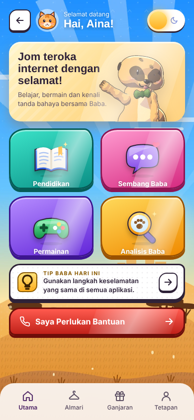
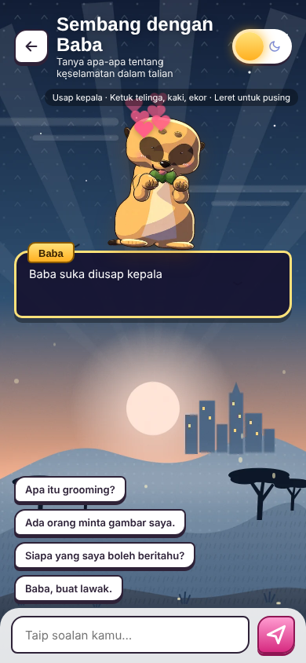
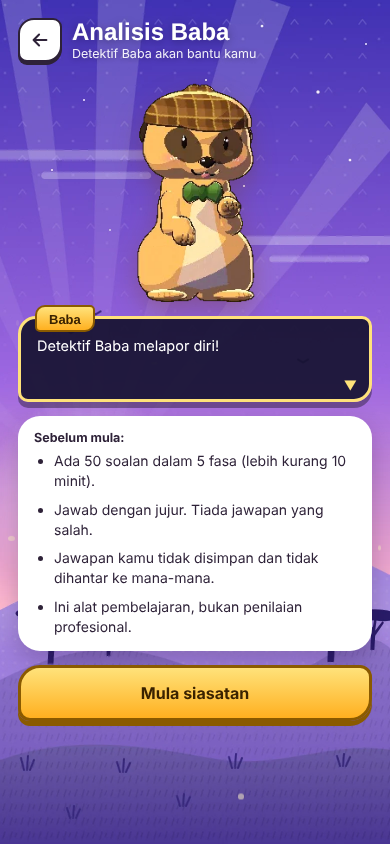
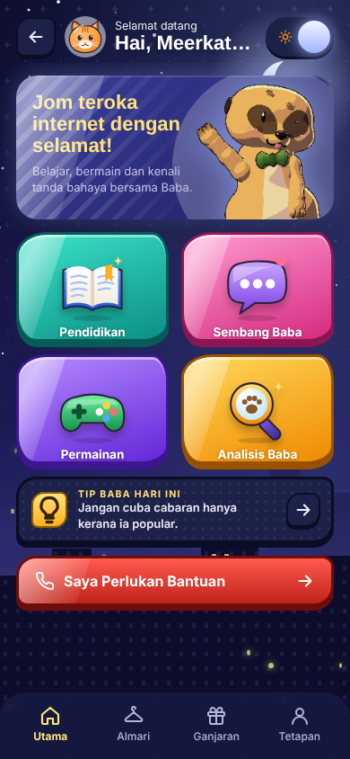

# Baba Chat 🦦

**Baba Chat** ialah aplikasi pendidikan keselamatan online untuk kanak-kanak berumur 7 hingga 12 tahun, khususnya untuk mencegah *grooming* dalam talian. Maskotnya ialah **Baba**, seekor meerkat yang sentiasa berjaga-jaga untuk kawan-kawannya.

Projek Kerja Sosial, Universiti Sultan Zainal Abidin (UniSZA) · **Kumpulan 10**

<p>




</p>

## Ciri-ciri

| Bahagian | Penerangan |
|---|---|
| **Sembang dengan Baba** | 2,810 soal jawab, termasuk soalan KBAT dan sembang susulan ("Boleh bagi contoh?", "Cuba terangkan lagi") yang merujuk topik terakhir. Usap kepala Baba, ketuk telinga, kaki atau ekor, dan leret untuk memusingkan Baba. Baba memahami ayat yang ditaip dengan cara berbeza dan singkatan (contoh: "sy", "nk", "bgtau"). Maklumat peribadi seperti nombor telefon ditapis secara automatik, dan notifikasi bahaya muncul apabila mesej berbahaya dikesan. |
| **Pendidikan** | 200 kad infografik dalam 14 kategori. Ketuk kad untuk mendengar dialog Baba. |
| **Permainan** | Kuiz Pantas (40 soalan bermasa), BabaCard (35 kad Selamat atau Bahaya), Simulasi Grooming (3,008 senario dalam 8 gaya aplikasi: mesej, game, media sosial, server, DM, kiriman, panggilan telefon dan panggilan video). Dua jenis: orang tidak dikenali, dan kawan yang bertukar jadi grooming. Senario dipilih secara rawak, dengan pilihan neutral, butang Hantar gambar, dan butang Sekat (menang terus ke senario seterusnya). |
| **Analisis Baba** | 50 soalan dalam 5 fasa, dengan 4 tahap keputusan dan nasihat khas. Jawapan tidak disimpan. |
| **Saya Perlukan Bantuan** | Nombor kecemasan 999, Talian Kasih 15999 dan WhatsApp, serta langkah Simpan, Sekat, Cerita. |
| **Ganjaran dan Almari** | Bintang, 9 lencana, hari berturut-turut dan 5 topi untuk Baba. |
| **Tetapan** | Muzik, bunyi, suara Baba, mod malam, uji bunyi, uji notifikasi bahaya. |

Tiada log masuk. Profil (nama samaran dan avatar haiwan) dan kemajuan disimpan dalam peranti sahaja.

## Cara membuka

**Melalui GitHub Pages:** buka pautan di bahagian *About* repo ini.

**Di komputer sendiri:** fail data perlu dibaca melalui pelayan, jadi jangan dwi-klik `index.html`.
1. Pasang [Visual Studio Code](https://code.visualstudio.com/) dan sambungan **Live Server**.
2. Buka folder ini, klik kanan `index.html` dan pilih **Open with Live Server**.

## Susunan folder

```
index.html          skrin aplikasi
css/style.css       warna, bentuk, mod malam
js/app.js           cara aplikasi berfungsi (skrin, enjin sembang, permainan, analisis, audio)
data/               KANDUNGAN: soalan, jawapan, nasihat, senarai bunyi (fail JSON)
assets/             gambar Baba, ikon, avatar, latar, muzik dan bunyi
docs/               dokumen kumpulan: panduan reka bentuk, senarai aset, bank soalan (Excel)
manifest.json, sw.js   membolehkan aplikasi dipasang di telefon dan dibuka tanpa internet
```

## Cara menukar kandungan

Semua soalan dan jawapan berada dalam folder `data/`, bukan dalam kod. Untuk menukar jawapan Baba, buka fail JSON yang berkaitan, tukar ayat di antara tanda petikan `" "`, kemudian simpan. Jangan padam tanda petikan, koma atau kurungan.

| Mahu tukar | Fail |
|---|---|
| Jawapan Sembang Baba | `data/qna-sembang.json` |
| Soalan Kuiz, BabaCard | `data/qna-permainan.json` |
| Senario Simulasi Grooming | `data/qna-simulasi-senario.json` |
| Saiz dan senarai animasi Baba | `data/baba-animasi.json` |
| Kad infografik | `data/qna-infografik.json` |
| Soalan dan keputusan Analisis | `data/qna-analisis.json` |
| Lagu setiap skrin | `data/audio.json` |

## Dibina dengan

three.js · WebGL (Baba 3D), Python · NumPy · SciPy (model, animasi dan muzik Baba), Web Audio API (muzik dan bunyi), HTML, CSS & JavaScript (antara muka). Fon: Baloo 2 dan Lexend (Google Fonts).

## Kumpulan 10

Muhammad Daniel Aiman bin Kamaruzaman · Muhammad Nabil Irsyad bin Mazlan · Nur Amira Shahirah binti Syameli · Nur Fatini binti Abdul Hadi · Siti Fatimah Az-Zahrah Albi binti Zufabillah · Wan Nurul Wardina Fakriyyah binti Wan Mohd Asri · Nur Izzati binti Roslani@Roslaini · Muhammad Husaini bin Mansor

> Analisis Baba ialah alat pendidikan dan saringan awal, bukan penilaian profesional. Jika kanak-kanak berada dalam bahaya, hubungi **999** atau **Talian Kasih 15999**.
